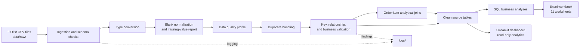

# Brazilian E-Commerce Data Pipeline

A Python data engineering and analytics project for the Brazilian E-Commerce Public Dataset by Olist. The pipeline ingests nine CSV files, profiles and cleans records, validates data quality, builds an order-item analytical table, stores outputs in SQLite, executes SQL analyses, and generates an Excel workbook.

The project is intended for educational and portfolio demonstration. Raw dataset files are local inputs and are not committed.

## Objectives

- Load and profile all nine source datasets reproducibly.
- Apply explicit type, missing-value, duplicate, and validation rules without arbitrary imputation.
- Preserve the original raw CSV inputs.
- Create an order-item analytical table with validated many-to-one joins.
- Store cleaned source tables and analytical data in SQLite.
- Report delivered sales separately from all-status item value, and provide payment reconciliation context.
- Automate quality and business reporting in Excel.

## Architecture



## Pipeline workflow

Running `python main.py` performs these steps in order:

1. Checks for and loads all nine expected CSV files from `data/raw/`.
2. Converts known date, nullable integer, and ZIP-prefix columns; invalid non-empty dates and non-integer values raise errors.
3. Normalizes blank text fields to missing values, preserves missing records, and records missing-value counts and policies.
4. Profiles the normalized datasets. The `Data Quality` and `Missing Values` worksheets describe the same reporting stage: after type conversion and blank-string normalization, before duplicate handling.
5. Removes exact duplicate geolocation rows from the processed copy only. Other rows and repeated business identifiers are retained and reported.
6. Validates required columns, keys, selected foreign-key relationships, allowed order statuses, monetary values, review scores, product dimensions, and selected timestamp ordering rules. Validation errors stop output generation; warnings are retained in the report.
7. Builds an item-grain analytical table by joining order items to orders, products, category translations, sellers, and customers. Joins are validated as many-to-one and the row count is checked against the order-items input.
8. Replaces SQLite source/analytical tables with the current run's data and executes the business-analysis SQL.
9. Writes the Excel workbook and pipeline log.

The pipeline reads raw CSVs and does not write to them. Validation is not a substitute for business review: warning findings do not block the run.

## Repository structure

```text
.
├── .github/
│   └── workflows/
│       └── ci.yml
├── .gitignore
├── README.md
├── data/
│   ├── processed/
│   │   └── .gitkeep
│   └── raw/                    # Nine local CSVs are ignored by Git
│       └── .gitkeep
├── database/
│   └── .gitkeep
├── logs/
│   └── .gitkeep
├── reports/
│   └── .gitkeep
├── src/
│   ├── analysis/
│   │   ├── __init__.py
│   │   └── business_queries.py
│   ├── cleaning/
│   │   ├── __init__.py
│   │   ├── clean_data_types.py
│   │   ├── handle_duplicates.py
│   │   └── handle_missing_values.py
│   ├── database/
│   │   ├── __init__.py
│   │   └── storage.py
│   ├── ingestion/
│   │   ├── __init__.py
│   │   ├── inspect_data.py
│   │   ├── loader.py
│   │   └── profile_data.py
│   ├── reporting/
│   │   ├── __init__.py
│   │   └── excel_report.py
│   ├── transformation/
│   │   ├── __init__.py
│   │   └── build_analytical_data.py
│   ├── validation/
│   │   ├── __init__.py
│   │   └── validate_data.py
│   └── logging_config.py
├── tests/
│   └── test_pipeline.py
├── dashboard/
│   ├── app.py
│   ├── config.py
│   ├── database.py
│   ├── queries.py
│   ├── components.py
│   ├── charts.py
│   └── pages/
│       ├── overview.py
│       ├── sales.py
│       ├── products.py
│       ├── customers.py
│       ├── payments_operations.py
│       └── order_explorer.py
├── main.py
└── requirements.txt
```

## Requirements and installation

Python 3.11 or newer is required. SQLite and Python logging use the standard library.

```bash
git clone <your-repository-url>
cd ecommerce-automation-system
python3 -m venv .venv
```

Activate the environment:

```bash
# macOS/Linux
source .venv/bin/activate

# Windows PowerShell
.venv\Scripts\Activate.ps1
```

Install dependencies:

```bash
python -m pip install -r requirements.txt
```

Download the nine CSV files from the attributed dataset and place them in `data/raw/`. These files are intentionally excluded from Git. The loader fails with an explicit list if any required file is missing.

## Run and test

From the repository root with the virtual environment active:

```bash
python main.py
```

The automated tests use in-memory/sample fixtures and temporary output files; they do not require the Olist CSV files:

```bash
python -m pytest -q
```

## Interactive business intelligence dashboard

The separate Streamlit dashboard reads the existing SQLite database in read-only mode. It does not reload raw CSVs, write to the database, or replace the batch pipeline or Excel report.

Install the project's dependencies in the active virtual environment:

```bash
python -m pip install -r requirements.txt
```

Run the existing pipeline first if `database/ecommerce.db` has not been generated, then launch from the project root:

```bash
streamlit run dashboard/app.py
```

### Dashboard features and architecture

- **Executive Overview:** delivered item revenue and orders, unique customers, average order value, monthly value trend, order statuses, revenue versus freight, and leading customer states.
- **Sales Analytics:** monthly, quarterly, and yearly comparisons; delivered revenue versus all-status item value; customer-state revenue and order trends.
- **Product Intelligence:** category revenue and contribution rankings, meaningful bottom categories, and product-ID performance with interactive category drill-down.
- **Customer Intelligence:** state distribution, order frequency, filtered repeat-order counts, and review score distribution.
- **Payments & Operations:** payment type and installment distributions, payment reconciliation, freight, delivery duration, and delays against estimates.
- **Order Explorer:** order-ID search, globally filtered order details, associated payment/review/delivery context, and CSV export (up to 500 rows per search).

`dashboard/app.py` provides navigation and the shared filter controls. `dashboard/queries.py` contains parameterized SQL aggregations, `dashboard/database.py` owns read-only cached access, and `dashboard/components.py` / `dashboard/charts.py` provide the shared interface. Page-specific rendering lives in `dashboard/pages/`. Global purchase-date, customer-state, product-category, and order-status filters apply across views. Refresh clears the query cache; it does not run or modify the pipeline.

### Metric definitions and limitations

- **Delivered item revenue** is `SUM(order_items.price)` for orders whose status is exactly `delivered`; it excludes freight. **Delivered item price + freight** is shown separately where relevant.
- **All-status item value** is item price plus freight for items regardless of order status; it is never labelled as delivered revenue.
- **Average order value** is delivered item revenue divided by delivered orders with qualifying item rows. Orders with multiple items count once in the denominator.
- **Unique customers** uses distinct `customer_unique_id` values among filtered orders. The filtered repeat-order view counts customers with at least two distinct orders within the active selection; it is not lifetime retention.
- Payment totals are summed from payment records and item/freight totals from order-item records. These measures are not presumed to reconcile. Category-filtered reconciliation includes all item lines and payment records for qualifying orders because payments are not allocated to product categories.
- Review distributions count available review rows; repeated review IDs are retained by the existing pipeline. Customer-level sentiment attribution is not inferred.
- The source supplies product IDs, not product names. Category translations may be missing; those products are grouped by their raw category name or `Unknown`.
- Monetary values remain in the dataset's source currency (displayed as R$); no currency conversion is performed. Product margin, cost, profit, customer lifetime value, and cohort retention are not available from these tables.
- Delivery metrics require non-null purchase, delivered, and estimated timestamps as appropriate. Negative or anomalous durations are retained rather than silently corrected. Review averages and payment values are record-level observations, not deduplicated.
- Product and order detail tables are capped (50 top products and 500 orders per search). Apply filters to explore other records. The geolocation table is not loaded by the dashboard.

### Screenshots

_Screenshot placeholder: add dashboard captures here._

GitHub Actions runs the same test suite on Python 3.12. It does not download the dataset or access secrets.

## Generated outputs

Successful pipeline runs create:

- `database/ecommerce.db` — nine cleaned source tables and `order_item_sales`.
- `reports/ecommerce_report.xlsx` — the 11 worksheets listed below.
- `logs/ecommerce_pipeline.log` — execution details, warnings, and errors.

The database, workbook, logs, raw/processed data, Python caches, and virtual environments are excluded from Git. Outputs are regenerated by running the pipeline; they are not included in this repository.

### Excel worksheets

| Worksheet | Contents |
|---|---|
| `Data Quality` | Per-column types, row/column counts, missing counts/percentages, and exact duplicate counts at the normalized profiling stage. |
| `Missing Values` | Nonzero missing counts, dataset-specific preservation policy, and the reporting-stage label. |
| `Duplicates` | Exact and configured business-key duplicate counts, any removed rows, and handling applied. |
| `Validation` | Validation rule status, number of findings, and sample identifiers/values. |
| `Monthly Sales (Delivered+All)` | Delivered-only order/item counts, item revenue, freight and total value, alongside separately labelled all-status item value and counts. |
| `Sales by State (Delivered+All)` | Order counts and item price/freight/value totals by customer state, with delivered-only measures alongside all-status measures. |
| `Top Categories (Delivered+All)` | Top 20 categories ranked by delivered total value, with delivered-only and all-status counts and amounts. |
| `Payment Reconciliation` | All-status payment value, item-price total, freight total, their sum, the difference, and a note that the measures require investigation rather than implying an error. |
| `Payment Types` | Payment-record counts, distinct order counts, and payment values by payment type. |
| `Review Scores` | Review counts by score. |
| `Order Status` | Order counts by status. |

`Delivered` means `order_status = 'delivered'`. All-status item value means item price plus freight for items in any order status; it is **not** completed revenue. Payment values and item-price/freight totals are different financial measures and are not guaranteed to reconcile.

## Technologies

- Python 3.11+
- Pandas for CSV handling, data profiling, and transformations
- SQLite and SQL for persistence and analysis
- OpenPyXL for Excel workbook generation
- Python `logging` for run diagnostics
- pytest for automated tests
- GitHub Actions for continuous integration

## Observed dataset findings and limitations

The latest generated report/database showed:

- 261,831 exact duplicate geolocation rows removed from the processed copy; raw geolocation CSV is unchanged.
- 814 repeated review-ID rows reported; review records are retained and the IDs are not treated as proof of duplicate reviews.
- 4 product rows with zero weight, 166 carrier timestamps before purchase, and 23 customer-delivery timestamps before carrier handoff; these are warnings, not repaired values.
- All-status payments totaled 16,008,872.12, while item price plus freight totaled 15,843,553.24, a difference of 165,318.88. These are different measures and the difference is not inherently an error.

These are observations from the current local dataset run, not guarantees for other dataset versions. Sales calculations use source currency with no currency conversion. The analytical fact is item-grain, not payment-grain. Geolocation rows are profiled and stored, but not joined into the order-item fact. The project is a local batch pipeline: it does not include cloud orchestration, a dashboard, deployment, or production alerting. Validation only implements the rules listed in the code and does not certify the source as error-free.

## Dataset attribution and licensing

- **Dataset:** Brazilian E-Commerce Public Dataset by Olist
- **Source:** [Kaggle dataset page](https://www.kaggle.com/datasets/olistbr/brazilian-ecommerce)
- **Dataset license:** CC BY-NC-SA 4.0
- **Purpose:** Educational and portfolio demonstration

The dataset license applies to the dataset and its licensed contents. It does not automatically apply to original code in this repository. No license for the original project code has been selected or declared here; that decision remains with the project owner. Review the dataset license and attribution requirements before redistributing dataset contents or derivatives.
