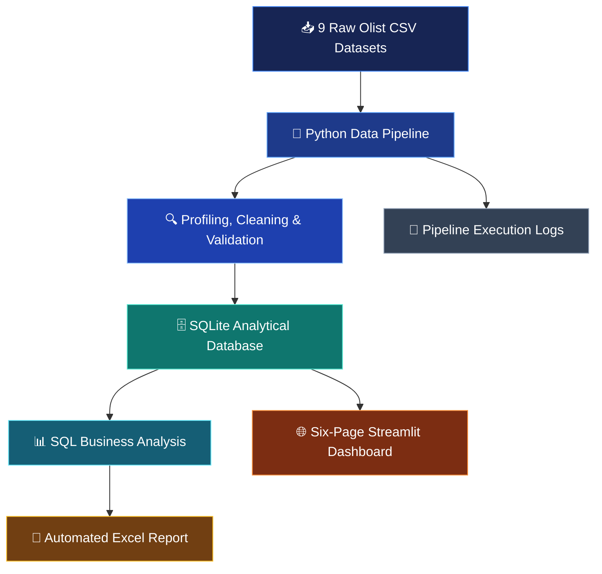

<div align="center">


### From Raw Marketplace Data to Business Intelligence

**An end-to-end data pipeline, analytical database, automated reporting system,<br/>and interactive business intelligence dashboard.**

<br/>

<a href="https://olist-commerce-intelligence.streamlit.app"></a>
<a href="https://github.com/Tuberamesh/ecommerce-automation-system"></a>

<br/>


</div>

---

## 📌 Project at a Glance

Olist Commerce Intelligence turns raw Brazilian e-commerce marketplace data into structured, validated, and interactive business intelligence.

It combines **data engineering, SQL analytics, automated Excel reporting, and dashboard development** in one end-to-end workflow.

<div align="center">

<table>
  <tr>
    <td align="center"><h3>9</h3><sub>Source CSV Files</sub></td>
    <td align="center"><h3>99,441</h3><sub>Orders</sub></td>
    <td align="center"><h3>112,650</h3><sub>Order Items</sub></td>
    <td align="center"><h3>32,951</h3><sub>Products</sub></td>
  </tr>
  <tr>
    <td align="center"><h3>6</h3><sub>Dashboard Pages</sub></td>
    <td align="center"><h3>11</h3><sub>Excel Worksheets</sub></td>
    <td align="center"><h3>SQLite</h3><sub>Analytical Database</sub></td>
    <td align="center"><h3>Pytest</h3><sub>Automated Tests</sub></td>
  </tr>
</table>

</div>

---

## ✨ What This Project Does

| | Capability | Description |
|---|---|---|
| 🔧 | **Data Engineering** | Processes nine raw CSV datasets through a structured pipeline |
| 🧹 | **Data Quality** | Profiles, cleans, validates, and transforms marketplace data |
| 🗄️ | **Database Management** | Stores processed datasets in a relational SQLite database |
| 📊 | **Business Analytics** | Uses SQL to analyze sales, customers, products, payments, and operations |
| 📑 | **Automated Reporting** | Generates an Excel workbook with 11 analytical worksheets |
| 🌐 | **Business Intelligence** | Provides a six-page interactive Streamlit dashboard |
| ☁️ | **Cloud Deployment** | Public dashboard backed by a separate, reduced deployment database |

---

## 🏗️ System Architecture



### Pipeline Stages

| Stage | Step | Implementation |
|:---:|---|---|
| **01** | Ingestion | Loads nine source CSV datasets using Pandas |
| **02** | Profiling | Examines data types, missing values, and duplicates |
| **03** | Cleaning | Normalizes supported data types and blank values |
| **04** | Validation | Checks keys, relationships, timestamps, and business rules |
| **05** | Transformation | Builds an order-item analytical dataset using validated joins |
| **06** | Storage | Saves processed datasets in SQLite |
| **07** | Analysis | Executes SQL-based business analysis |
| **08** | Reporting | Generates Excel reports and pipeline logs |

---

## 📊 Interactive Dashboard

<div align="center">

<a href="https://olist-commerce-intelligence.streamlit.app"></a>

*Explore the marketplace from six analytical perspectives*

</div>

| Page | What You Can Explore |
|---|---|
| 🏠 **Executive Overview** | Marketplace KPIs, delivered sales, order trends, and order status |
| 💰 **Sales Analytics** | Monthly and yearly trends, regional demand, and sales comparisons |
| 📦 **Product Intelligence** | Category performance, product rankings, and category drill-down |
| 👥 **Customer Intelligence** | Customer distribution, order frequency, and review patterns |
| 💳 **Payments & Operations** | Payment methods, installments, reconciliation, and delivery metrics |
| 🔎 **Order Explorer** | Individual order lookup, order details, and CSV export |

**Dashboard capabilities:** interactive filters and visual exploration · SQL-powered data retrieval · order-level investigation · CSV export for selected orders · read-only database access.

<!--
📸 Add screenshots here for a big visual upgrade:
1. Create a folder: docs/screenshots/
2. Add images, then uncomment:

<div align="center">
  
  
</div>
-->

---

## ⚙️ Technology Stack

| Technology | Purpose |
|---|---|
| **Python** | Core programming and pipeline orchestration |
| **Pandas** | Data ingestion, cleaning, and transformation |
| **SQL** | Analytical queries and business insights |
| **SQLite** | Relational analytical database |
| **Streamlit** | Interactive dashboard |
| **Plotly** | Interactive data visualizations |
| **OpenPyXL** | Automated Excel report generation |
| **Pytest** | Automated testing |
| **Git & GitHub** | Version control and source management |
| **GitHub Actions** | Automated test workflow |

---

## 🔍 Data Quality & Validation

Instead of silently modifying every anomaly, the pipeline **identifies and reports** validation findings.

### Observed findings from the current dataset run

| Finding | Observation |
|---|---:|
| Exact duplicate geolocation rows removed from processed copy | **261,831** |
| Repeated review IDs retained for investigation | **814** |
| Products with zero recorded weight | **4** |
| Carrier timestamps earlier than purchase timestamps | **166** |
| Customer-delivery timestamps earlier than carrier handoff | **23** |
| Difference between all-status payment totals and item-plus-freight totals | **R$165,318.88** |

> [!NOTE]
> These are observations from the current dataset version, not guarantees for other dataset versions.

---

## 📐 Analytical Definitions & Limitations

To avoid misleading business conclusions, the dashboard separates different financial and operational measures.

| Measure | Definition |
|---|---|
| **Delivered item revenue** | Item prices for orders with status `delivered`; freight is reported separately |
| **All-status item value** | Item price plus freight across all order statuses |
| **Average order value** | Delivered item revenue ÷ qualifying delivered orders |
| **Customer count** | Based on distinct customer identifiers |
| **Payment totals** | Reported separately from item and freight totals; the measures are not assumed to reconcile |
| **Currency** | Brazilian Real (BRL) |

> [!IMPORTANT]
> The source dataset has no product costs or profit margins, so **profit, margin, and customer lifetime value are not calculated**. Timestamp anomalies and validation findings are reported rather than silently corrected.

---

## 🚀 Run Locally

**1. Clone the repository**

```bash
git clone https://github.com/Tuberamesh/ecommerce-automation-system.git
cd ecommerce-automation-system
```

**2. Create a virtual environment**

```bash
python3 -m venv .venv
source .venv/bin/activate
```

On Windows PowerShell:

```powershell
.venv\Scripts\Activate.ps1
```

**3. Install dependencies**

```bash
python -m pip install -r requirements.txt
```

**4. Download the dataset**

Get the [Brazilian E-Commerce Public Dataset by Olist](https://www.kaggle.com/datasets/olistbr/brazilian-ecommerce) and place all nine CSV files inside `data/raw/`.

**5. Run the pipeline**

```bash
python main.py
```

**6. Run automated tests**

```bash
python -m pytest -q
```

**7. Launch the dashboard**

```bash
streamlit run dashboard/app.py
```

Then open `http://localhost:8501` in your browser.

---

## 🗄️ Database & Deployment

The project supports separate local and deployment-oriented databases.

| Database | Purpose |
|---|---|
| `database/ecommerce.db` | Full local development database |
| `database/deployment_ecommerce.db` | Reduced deployment database with pseudonymized identifiers |

The app prefers the full local database when available, otherwise it uses the deployment database.

To select a database explicitly:

```bash
OLIST_DATABASE_PATH=database/deployment_ecommerce.db streamlit run dashboard/app.py
```

To generate the deployment database:

```bash
python scripts/create_deployment_db.py
```

> [!NOTE]
> The deployment database reduces the fields and direct identifiers included in the deployment copy. Pseudonymization does not guarantee anonymity.

Raw CSV files, processed datasets, database files, and pipeline logs are excluded from the public Git repository.

### Generated Outputs

| Output | Description |
|---|---|
| `database/ecommerce.db` | Full processed SQLite database |
| `database/deployment_ecommerce.db` | Reduced deployment-oriented database |
| `reports/ecommerce_report.xlsx` | Automated Excel report with 11 worksheets |
| `logs/` | Pipeline execution logs |

These files are generated locally and are not included in the public repository.

---

## 📁 Project Structure

<details>
<summary><b>Click to expand</b></summary>

```text
ecommerce-automation-system/
│
├── .github/
│   └── workflows/
│
├── dashboard/
│   ├── app.py
│   ├── config.py
│   ├── database.py
│   ├── queries.py
│   ├── components.py
│   ├── charts.py
│   └── pages/
│
├── data/
│   ├── raw/
│   └── processed/
│
├── database/
├── logs/
├── reports/
│
├── scripts/
│   └── create_deployment_db.py
│
├── src/
│   ├── analysis/
│   ├── cleaning/
│   ├── database/
│   ├── ingestion/
│   ├── reporting/
│   ├── transformation/
│   └── validation/
│
├── tests/
├── main.py
├── requirements.txt
└── README.md
```

</details>

---

## 📚 Dataset Credits & Licensing

**Brazilian E-Commerce Public Dataset by Olist**

- **Publisher:** Olist
- **Source:** [Kaggle – Brazilian E-Commerce Public Dataset](https://www.kaggle.com/datasets/olistbr/brazilian-ecommerce)
- **Dataset licence:** [CC BY-NC-SA 4.0](https://creativecommons.org/licenses/by-nc-sa/4.0/)

This project uses the Olist dataset for educational and analytical purposes. The original dataset is not owned or created by the project author.

The dataset licence is separate from the project code. Review the licence terms and attribution requirements before redistributing the dataset, derived databases, or other dataset-based materials.

**Code licence:** No separate open-source licence has currently been declared for this repository.

---

<div align="center">

## 👨‍💻 Built by Ramesha G

**B.Tech Data Science Student · New Horizon College of Engineering · Bengaluru**

Interested in Data Analytics, Python, SQL, and AI Engineering.<br/>
I build practical projects that turn data into useful insights and real-world applications.

<br/>

<a href="https://www.linkedin.com/in/ramesha-g/"></a>
<a href="https://github.com/Tuberamesh"></a>
<a href="https://www.instagram.com/decoder_space/"></a>
<a href="https://www.youtube.com/@The_Decoder_yt"></a>

<br/><br/>

### ⭐ Like this project?

Explore the live dashboard, star the repository, and feel free to connect!

<a href="https://olist-commerce-intelligence.streamlit.app"></a>
<a href="https://github.com/Tuberamesh/ecommerce-automation-system"></a>

<br/>

**Turning raw data into meaningful intelligence.**


</div>
