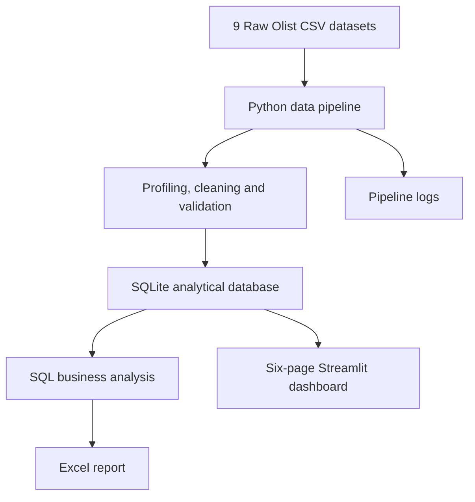

# Olist Commerce Intelligence

An end-to-end e-commerce analytics platform built using Python, Pandas, SQL, SQLite, Streamlit and Excel. The project processes the Brazilian E-Commerce Public Dataset by Olist and turns raw marketplace data into validated analytical datasets, business reports and an interactive dashboard.

## Project overview

- Processes 9 source CSV datasets.
- Covers approximately 99K orders and 112K order-item records.
- Implements data profiling, cleaning, validation and analytical transformations.
- Stores processed data in SQLite.
- Generates an automated Excel report with 11 worksheets.
- Includes a six-page interactive Streamlit dashboard.
- Provides order-level exploration and CSV export.

## Technology stack

Python · Pandas · SQL · SQLite · Streamlit · Plotly · OpenPyXL · Pytest · GitHub Actions

## Architecture



## Dashboard

The Streamlit application contains six analytical sections:

| Page | Features |
|---|---|
| Executive Overview | Marketplace KPIs, delivered sales, order trends and status distribution |
| Sales Analytics | Monthly and yearly trends, regional demand and sales comparisons |
| Product Intelligence | Category performance, product rankings and category drill-down |
| Customer Intelligence | Customer distribution, order frequency and review patterns |
| Payments & Operations | Payment methods, installments, payment reconciliation and delivery metrics |
| Order Explorer | Individual order lookup, order details and CSV export |

The dashboard uses read-only SQLite access and parameterized SQL queries. Shared filters allow users to explore the data across dashboard pages.

## Data pipeline

Run `python main.py` from the repository root to execute the batch pipeline.

The pipeline:

1. Loads and profiles the nine expected CSV datasets.
2. Converts supported data types and normalizes blank values.
3. Reports missing values and duplicate records.
4. Validates selected keys, relationships, business rules and timestamps.
5. Builds an order-item analytical dataset using validated joins.
6. Stores processed source tables and analytical data in SQLite.
7. Executes SQL business analyses.
8. Generates an Excel workbook and pipeline logs.

Raw CSV files are read as inputs and are not modified by the pipeline.

## Installation

Python 3.11 or newer is recommended.

```bash
git clone https://github.com/Tuberamesh/ecommerce-automation-system.git
cd ecommerce-automation-system

python3 -m venv .venv
source .venv/bin/activate

python -m pip install -r requirements.txt
```

On Windows PowerShell, activate the environment with:

```powershell
.venv\Scripts\Activate.ps1
```

## Dataset setup

Download the Brazilian E-Commerce Public Dataset by Olist from Kaggle:

https://www.kaggle.com/datasets/olistbr/brazilian-ecommerce

Place the nine CSV files in:

```text
data/raw/
```

The raw dataset and generated database files are excluded from Git. Review the dataset's license and attribution requirements before redistributing the dataset or derived data.

## Run the pipeline

```bash
python main.py
```

## Run tests

```bash
python -m pytest -q
```

## Run the dashboard locally

The dashboard reads an existing SQLite database. Run the pipeline first if the full local database has not been generated.

```bash
streamlit run dashboard/app.py
```

Open the local URL displayed by Streamlit, usually:

```text
http://localhost:8501
```

### Database selection

The application supports two database configurations:

- `database/ecommerce.db`: full local development database.
- `database/deployment_ecommerce.db`: reduced deployment-oriented database with pseudonymized identifiers.

By default, the application uses the full local database when it exists. Otherwise, it falls back to the deployment database.

To explicitly select a database, set `OLIST_DATABASE_PATH`:

```bash
OLIST_DATABASE_PATH=database/deployment_ecommerce.db streamlit run dashboard/app.py
```

The deployment database is generated separately by:

```bash
python scripts/create_deployment_db.py
```

It is intended to reduce the fields and direct identifiers included in a deployment copy. Pseudonymization does not guarantee anonymity.

## Generated outputs

| Output | Description |
|---|---|
| `database/ecommerce.db` | Full processed SQLite database |
| `database/deployment_ecommerce.db` | Reduced deployment-oriented database |
| `reports/ecommerce_report.xlsx` | Automated Excel report with 11 worksheets |
| `logs/` | Pipeline execution logs |

Database files, raw data, processed data and logs are generated locally and are not included in the repository.

## Analytical definitions and limitations

- Delivered item revenue is calculated from item prices for orders with status `delivered`; freight is reported separately.
- All-status item value includes item price and freight across order statuses. It is not the same as delivered revenue.
- Average order value uses delivered item revenue divided by qualifying delivered orders.
- Customer counts use distinct customer identifiers.
- Payment totals and item/freight totals are separate measures and are not assumed to reconcile.
- The source dataset does not provide product costs or profit margins. Profit, margin and customer lifetime value are therefore not calculated.
- Monetary amounts remain in the source currency, Brazilian real (BRL).
- Timestamp anomalies and other validation findings are reported rather than silently corrected.

## Observed data-quality findings

The current dataset run identified:

- 261,831 exact duplicate geolocation rows removed from the processed copy.
- 814 repeated review IDs, retained for investigation rather than automatically treated as duplicate reviews.
- 4 products with zero recorded weight.
- 166 carrier timestamps earlier than purchase timestamps.
- 23 customer-delivery timestamps earlier than carrier handoff timestamps.
- A difference of R$165,318.88 between all-status payment totals and item price plus freight totals.

These are observations from the current dataset version, not guarantees for other versions.

## Dataset attribution and licensing

**Dataset:** Brazilian E-Commerce Public Dataset by Olist
**Source:** https://www.kaggle.com/datasets/olistbr/brazilian-ecommerce
**Dataset license:** CC BY-NC-SA 4.0

The dataset is licensed separately from the original code in this repository. Review the license terms and attribution requirements before redistributing the dataset, derived databases or other dataset-based materials.

The original project code does not currently declare a separate open-source license.

## Repository structure

```text
.
├── .github/workflows/
├── dashboard/
│   ├── app.py
│   ├── config.py
│   ├── database.py
│   ├── queries.py
│   ├── components.py
│   ├── charts.py
│   └── pages/
├── data/
│   ├── raw/
│   └── processed/
├── database/
├── logs/
├── reports/
├── scripts/
│   └── create_deployment_db.py
├── src/
│   ├── analysis/
│   ├── cleaning/
│   ├── database/
│   ├── ingestion/
│   ├── reporting/
│   ├── transformation/
│   └── validation/
├── tests/
├── main.py
├── requirements.txt
└── README.md
```

## Continuous integration

GitHub Actions runs the automated test suite using Python 3.12. The workflow does not download the Olist dataset or require database files.
